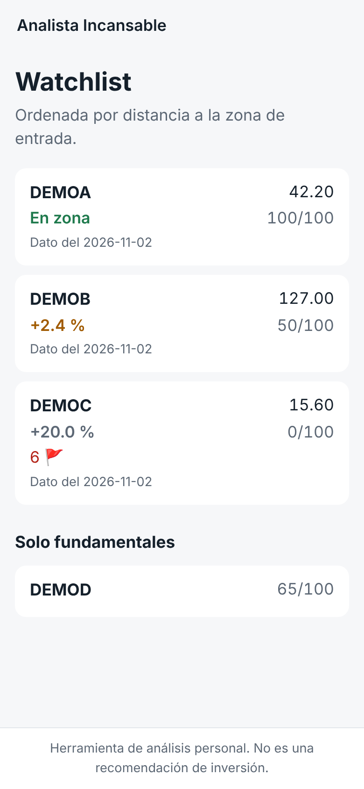
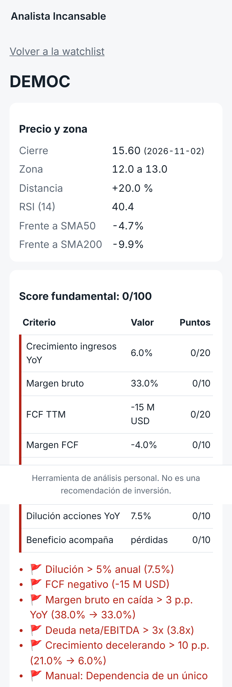

# Analista Incansable: fundamental screener and watchlist alerts

A personal tool that watches a list of stocks every day, scores each company on its
fundamentals and sends an alert when something worth a second look happens. It runs on
a home server (Ubuntu) inside a private network.

**Design rule: it analyses and watches, it never predicts.** It does not emit buy or sell
signals and it is not connected to any broker. Every message ends with the reminder that
it is not investment advice; the decision always stays with the user.

| Watchlist (synthetic demo data) | Ticker detail (synthetic demo data) |
|---|---|
|  |  |

## What it does

1. **Ingestion** (`src/ingesta.py`): downloads one year of daily prices and the annual
   financial statements for every ticker with `yfinance`, and stores them in SQLite.
   Any metric that is missing is stored as `NULL` and shown as `s/d`: **data is never
   invented or interpolated.**
2. **Fundamental score** (`src/analisis.py`): an 8-criteria checklist that turns each
   company into a 0 to 100 score, plus red flags that are always listed separately
   (they are never averaged away).
3. **Daily report** (`src/informe.py`): distance from the close to each entry zone,
   RSI(14), price against the 50 and 200-session moving averages, and the latest score.
4. **Alerts** (`src/alertas.py`, `src/titulares.py`): entering an entry zone, getting within
   3% of it, crossing the 200-session average, or a new red flag appearing. Zone alerts
   always include the latest headlines ("why has it moved?") and the manual note for the
   ticker. An anti-spam table prevents the same alert from repeating for 5 days.
   Output is JSON for an n8n workflow, or the alerts can be sent straight to Telegram.
5. **Read-only panel** (`panel/`): a small FastAPI site, designed for the phone, to check
   the watchlist from anywhere inside the private network. It has no write endpoints.

## The score

Weights and thresholds live in `config.yaml`, so the method can be tuned without
touching code. Green earns full points, amber half, red or missing data zero.

| Criterion | Metric | Green | Amber | Weight |
|---|---|---|---|---:|
| Growth | Revenue YoY | > 20% | 10 to 20% | 20 |
| Margin quality | Gross margin | > 50% | 35 to 50% | 10 |
| Real profitability | Free cash flow | positive and growing | positive | 20 |
| Cash conversion | FCF margin | > 10% | 5 to 10% | 10 |
| Balance sheet | Net debt / EBITDA | < 1x or net cash | 1 to 3x | 10 |
| Return | ROE | > 15% | 8 to 15% | 10 |
| Dilution | Share count YoY | < 2% | 2 to 5% | 10 |
| Earnings follow | Net income growth vs revenue growth | keeps up | positive but slower | 10 |

Red flags: dilution above 5% a year, negative free cash flow, gross margin falling more
than 3 points, net debt above 3x EBITDA, revenue growth decelerating more than 10 points,
plus any manual flag written in the config.

## Architecture

```text
cron or n8n (07:30, Tue to Sat)
        │
        ▼
 src.ingesta ──► SQLite ◄── src.analisis (score + flags)
   (yfinance)      │
                   ├──► src.informe   daily report in the terminal
                   ├──► src.alertas   JSON for n8n, or Telegram directly
                   └──► panel/        read-only FastAPI site for the phone
```

Stack: Python, pandas, yfinance, SQLite, FastAPI, Jinja2, n8n, Telegram Bot API.

## Running it

```bash
python3 -m venv .venv && source .venv/bin/activate
pip install -r requirements-dev.txt

python -m src.ingesta        # prices + fundamentals + scores for the watchlist
python -m src.informe        # daily report
python -m src.alertas        # preview pending alerts (records nothing)
python -m src.alertas --json # JSON for n8n, records the alerts (anti-spam)

cp .env.example .env         # TELEGRAM_BOT_TOKEN and TELEGRAM_CHAT_ID
python -m src.alertas --enviar

uvicorn panel.app:app --host 0.0.0.0 --port 8080   # only inside the private network
```

Try everything without network access, on synthetic data:

```bash
python -m scripts.demo
ANALISTA_DB=demo/datos.db ANALISTA_CONFIG=demo/config.yaml uvicorn panel.app:app --port 8080
```

The `DEMO*` tickers and their figures are invented; the scores shown for them are
computed by the real engine.

## Tests

```bash
python -m pytest
```

22 tests, all without network: the score on synthetic green, amber and red companies,
zone and proximity alerts, crossings of the 200-session average in both directions, new
red flags compared without their changing values, anti-spam windows, headline parsing in
both `yfinance` formats, graceful failure when there is no network, and the read-only panel.

## Status and roadmap

The project is built phase by phase from a written specification
(`SPEC_analizador_inversiones.md` and its annexes, in Spanish).

- **Done:** watchlist tracker (phase 1), fundamental screener (phase 2), alerts with
  headlines and anti-spam (phase 3) and the read-only panel (phase 6).
- **Next:** per-ticker investment thesis report (phase 2.5), RAG over SEC 10-K and 10-Q
  filings with Qdrant and a local LLM (phase 4), a weekly discovery screener (phase 7)
  and, optionally, rule backtesting (phase 5).

`config.yaml` contains the author's own watchlist and reference levels. They are personal
monitoring levels, not recommendations.

---
Built by Joaquín Borja León.
